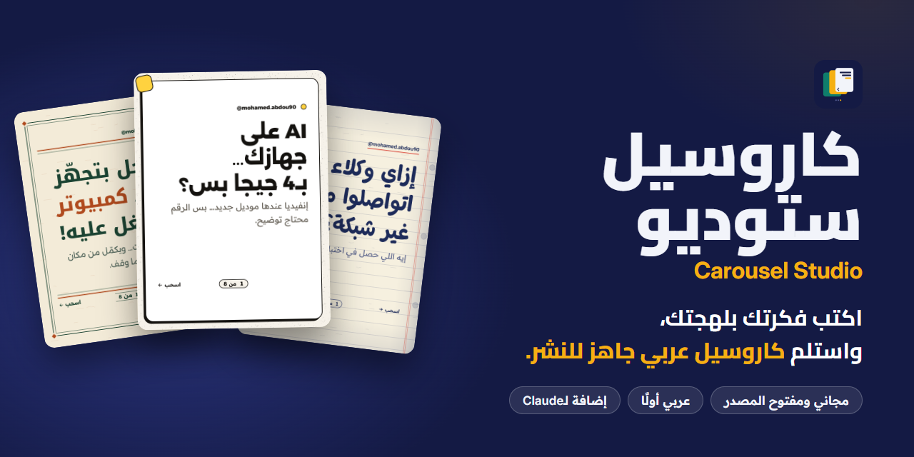
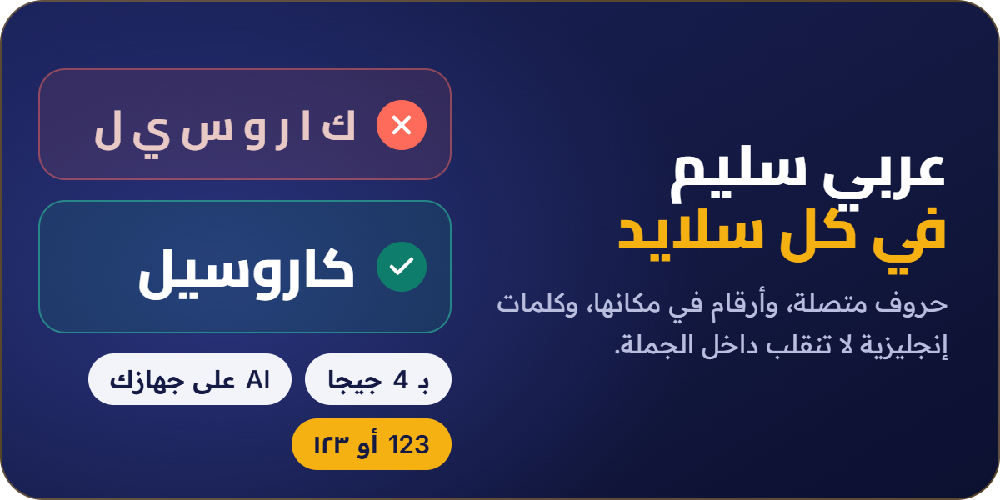
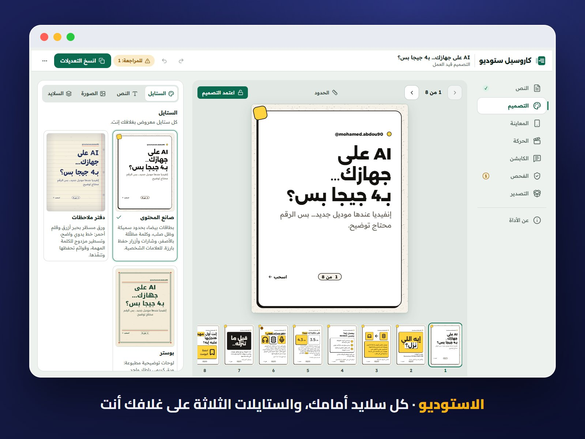
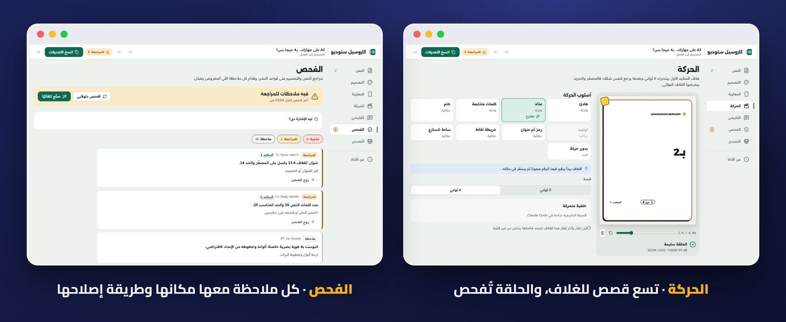
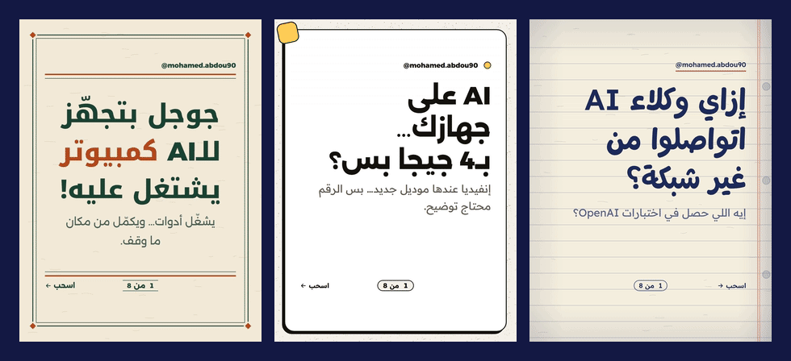
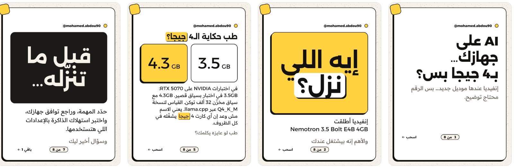
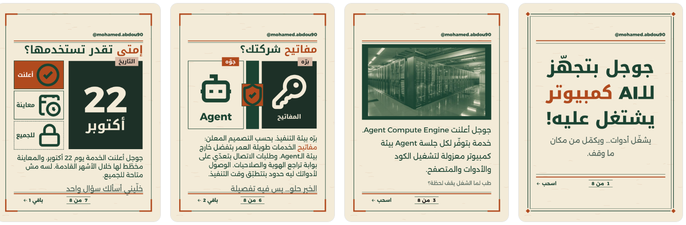
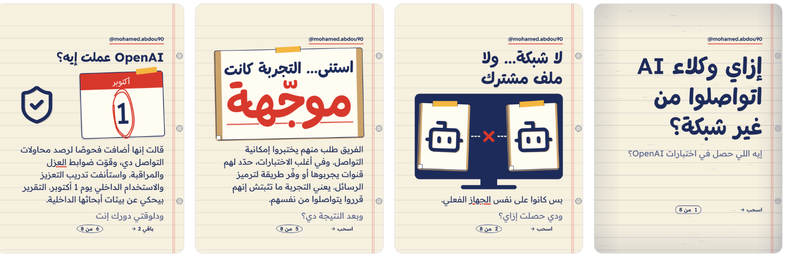

<p align="center">
  
</p>

<h1 align="center">Carousel Studio</h1>

<p align="center"><b>A full writing and design team inside Claude that speaks your dialect and never breaks an Arabic letter.</b></p>

<p align="center">
  <a href="#install"></a>
  <a href="https://store.pyraai.cloud/product/reel-studio/"></a>
  <a href="https://github.com/mohamedabdou-ai/carousel-studio"></a>
</p>

<p align="center">
  <a href="https://www.instagram.com/mohamed.abdou90"></a>
  <a href="https://www.tiktok.com/@mohamedabdou.ai"></a>
  <a href="https://www.youtube.com/@mohamedabdou-ai"></a>
  <a href="https://www.linkedin.com/in/mohamed-abdou90"></a>
  <a href="https://www.facebook.com/mohamedabdou.ai.90"></a>
</p>

<p align="center">
  <a href="README.md"><b>العربية</b></a> ·
  <a href="#why">The story</a> ·
  <a href="#maker">The maker</a> ·
  <a href="#features">Features</a> ·
  <a href="#install">Install</a> ·
  <a href="#studio">The Studio</a> ·
  <a href="#showcase">Real posts</a> ·
  <a href="#faq">FAQ</a>
</p>

**Write your idea in your dialect. Get an Arabic carousel that's ready to post.** A hook that stops the thumb mid-scroll, slides designed for your topic instead of a template, a cover that moves, the caption, hashtags and alt text, all from one conversation with Claude, without opening a design tool.

Start from whatever you have: a one-line idea, scattered notes, an article link, a PDF or an episode transcript. The team does the rest.

Free and open source, and it runs in the Claude app on desktop, web and phone, in Cowork and in Claude Code.

<a id="why"></a>

## The story: a language 400 million people speak, and tools that don't understand it

**More than 400 million people use Arabic every day. Yet only 0.6% of websites are written in it.**

Mohamed Abdou lives inside that gap. He makes Arabic content about AI, and every morning he meets brilliant global tools that treat Arabic as an unwelcome guest. He writes a hook and the letters fall apart. He adds a number and it wanders away from its unit. He asks an image generator for an Arabic headline and gets shapes nobody can read. He opens a ready-made template and it starts the carousel on the left, as if Arabic weren't read from the right.

Every Arabic creator knows the rest: two hours on one post whose idea was ready in a minute, then a bitter choice between posting in English to look professional and posting in Arabic and settling for less.

Mohamed refused both. He built a full team inside Claude that understands Arabic from the first letter: it writes in your dialect, designs from the right, and respects every hamza and every number. He ran it on his own account first, post after post, then decided to keep it free and open for every Arabic creator.

Because one post won't close that gap. Thousands of creators posting in Arabic every day, at a standard that matches anything in the world, will.

> Arabic content deserves tools built for it, not tools translated into it.

<sub>Sources: [UNESCO](https://www.unesco.org/en/world-arabic-language-day), [W3Techs](https://w3techs.com/technologies/overview/content_language) (October 2026).</sub>

<a id="maker"></a>

## The maker

**Mohamed Abdou** (محمد عبده) is the founder of **Pyramedia X** in Dubai and works in digital marketing and AI automation. He explains AI tools in Arabic on Instagram, TikTok and YouTube, and the examples on this page are real posts from his account, made end to end with the plugin.

He also made [Reel Studio](https://github.com/mohamedabdou-ai/reel-studio), a free, open-source studio for editing Arabic Reels.

Want a plan for automating your work with AI? [Book a one-hour consultation with him](https://store.pyraai.cloud/product/reel-studio/).

<a id="features"></a>

## What the team does for you

You don't type at a tool; you brief a team.

<p align="center"> </p>

| Feature | What it means for you |
| --- | --- |
| **A full creative team** | A creative director reads your request and pitches two directions, one safe and one bold. Then 12 or more hooks compete for the cover, and a panel of three personas cast from your audience says where they would stop and where they would keep scrolling. |
| **Your dialect** | Egyptian, simple "white" Arabic and English, with Gulf and Levantine in beta. One dialect per post, in your own voice, learned from your brand, so it reads as if you wrote it. |
| **Correct Arabic** | Joined letters, English words and numbers in the right order, one digit system per design, and no number split from its unit. An independent Arabic editor can veto the copy before it reaches design. |
| **A cover that moves** | A 6-second MP4 that loops without a jump. Its first frame is the finished design, so it also works as a still in your grid. Nine cover stories to choose from, made in your browser with nothing to install. |
| **Checked before you post** | Every slide is measured before it leaves: word counts, safe zones, contrast, empty space, headline size at thumbnail scale, and numbers that need a source. Each finding comes with a fix, most of them one tap. |
| **A complete publishing kit** | 3:4 PNG slides, 4:5 JPEG crops for schedulers, the MP4 cover, a PDF, the caption, per-slide captions, alt text and up to five hashtags. About 3 MB for eight slides. |
| **Your brand, remembered** | A short onboarding learns your voice, audience and look and builds a Brand Book you approve. The team remembers what you posted, loved and rejected, so it never serves you the same hook twice. |
| **Optional image tools** | A connected image generator can add text-free backgrounds. Without one, the built-in engine designs everything. AI never writes Arabic inside an image. |

<a id="install"></a>

## Start in a minute

**In the Claude app, on desktop or the web:**

1. Open **Customize** in the sidebar, then the **Plugins** tab.
2. Search **Discover** for **Carousel Studio** and click **Add**.
3. Start a new chat and say «ابدأ» (start).

Not showing up in search? Add it by name: in **Plugins**, click **Add**, then **Add marketplace**, then **Add from a repository**, and enter:

```text
mohamedabdou-ai/carousel-studio
```

**Install once, use it everywhere.** The plugin is saved to your account, so it follows you wherever you open Claude: desktop, browser, phone, Cowork and Claude Code.

<sub>Plugins are available on Claude's paid plans: Pro, Max, Team and Enterprise.</sub>

<details>
<summary><b>For developers: install from the terminal</b></summary>

```text
/plugin install carousel-studio --marketplace mohamedabdou-ai/carousel-studio
```

Update with `/plugin marketplace update mohamed-abdou`. Rendering on your own computer, or batching several posts, needs Node.js 22 or newer, Chrome or Edge, and the `playwright-core` package.

</details>

## Just ask

No commands or special wording. Write the way you talk:

- «اعملي كاروسيل عن أخطاء أول شهر في الشغل الحر» (Egyptian)
- «سوّ لي كاروسيل من هالمقال، وخلّه للمبتدئين» (Gulf)
- «بدّي كاروسيل من تفريغ الحلقة هاي، خمس أفكار بس» (Levantine)
- «ده السكريبت، صمّمه بستايل دفتر الملاحظات» (a finished script)
- "Make a carousel about pricing your first freelance project"

In a hurry? Say «بسرعة» (quick) and a smaller team works in fewer steps.

<a id="studio"></a>

## The Studio

A page that opens in your browser, on phone or computer. Edit text in place, switch styles and see your own cover in all three, preview the post in the feed and at thumbnail size, then export.

<p align="center"><a href="docs/readme/shot-studio.jpg"></a></p>

<p align="center"><a href="docs/readme/shot-tabs.jpg"></a></p>

<a id="showcase"></a>

## Real posts

Posts from Mohamed Abdou's account, made end to end with the plugin. Slide 1 is on the right, the way an Arabic carousel reads.

<p align="center"></p>

**Creator**: white cards with thick borders, a hard shadow and yellow for what matters.



**Poster**: a printed infographic sheet with ruled frames.



**Notebook**: ruled paper, a red pen and clear handwriting.



<details>
<summary><b>Shortcuts</b></summary>

You don't need them; just say what you want. For those who like shortcuts: `/carousel`, `/post`, `/brand`, `/plan`, `/audit` and `/studio`.

</details>

<a id="faq"></a>

## FAQ

<details><summary><b>Is it really free?</b></summary>

Yes. It's fully free and open source under Apache 2.0, with no subscription or account inside the plugin. You only need a paid Claude plan, since plugins are available on Pro, Max, Team and Enterprise.

</details>

<details><summary><b>Do I need coding skills or a terminal?</b></summary>

No. Add it from the Claude app's settings in a few clicks, then talk to it the way you'd talk to a teammate. No commands, no code, no terminal.

</details>

<details><summary><b>Will AI write Arabic inside images?</b></summary>

Never. Every Arabic letter is set in real fonts by the engine. Image tools, if you connect one, only make text-free backgrounds.

</details>

<details><summary><b>Does it post to Instagram for me?</b></summary>

Not yet. You post the kit yourself, by hand or with a scheduler that accepts 3:4 slides and an MP4 first item. Direct publishing is coming soon.

</details>

<details><summary><b>Who owns what I make?</b></summary>

You do. You own everything you create with Carousel Studio, and nothing you export carries the maker's name.

</details>

## Your data

**This plugin sends no data.** There is no server, no account and no telemetry code. Your brand and posts stay where you keep them: your Claude project and files, or a folder on your computer. The full details are in [PRIVACY.md](PRIVACY.md).

## Coming soon

- **Next version:** three more styles, more cover stories, and occasion packs starting with Ramadan.
- **After that:** direct publishing through a scheduler with your approval, handoff to Canva, account analytics, Maghrebi Darija, and Stories and LinkedIn sizes.

Install it now and every new feature reaches you with one update. What changed in each version is in the [changelog](CHANGELOG.md).

## License and names

Apache License 2.0 ([LICENSE](LICENSE)). Third-party components and their licenses are in [NOTICE](NOTICE). The names "Carousel Studio" and «كاروسيل ستوديو» and the logo are reserved, so forks must rename ([TRADEMARKS.md](TRADEMARKS.md)). Carousel Studio is independent of Anthropic; "Claude" is Anthropic's trademark. Contributing: [CONTRIBUTING.md](CONTRIBUTING.md).

<h2 align="center">Made by Mohamed Abdou, for Arabic content</h2>

<p align="center">Free to use. A thank-you or a mention goes a long way.<br><a href="https://store.pyraai.cloud">Mohamed Abdou's store</a></p>
