<div dir="rtl" lang="ar">

<p align="center">
  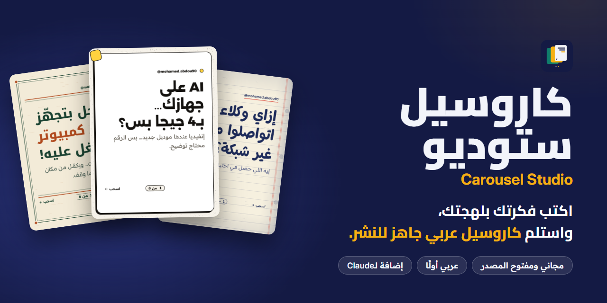
</p>

<h1 align="center">كاروسيل ستوديو</h1>

<p align="center"><b>فريق كتابة وتصميم كامل داخل Claude، يتكلم لهجتك، ولا يكسر حرفًا عربيًا واحدًا.</b></p>

<p align="center">
  <a href="#start">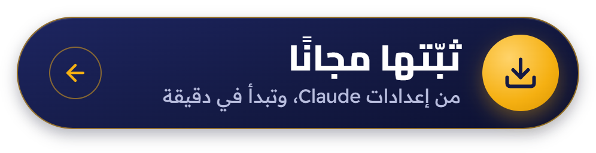</a>
</p>

<p align="center">
  <a href="https://store.pyraai.cloud/product/reel-studio/">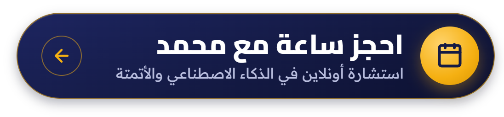</a>
  <a href="https://github.com/mohamedabdou-ai/carousel-studio"></a>
</p>

<p align="center">
  <sub>ساعة استشارة أونلاين مع محمد في الذكاء الاصطناعي والأتمتة، تخرج منها بخطة واضحة: ماذا تؤتمت أولًا، وبأي أداة.</sub>
</p>

<h3 align="center">تابع صانع الاستوديو</h3>

<p align="center">
  <a href="https://www.instagram.com/mohamed.abdou90"></a>
  <a href="https://www.tiktok.com/@mohamedabdou.ai">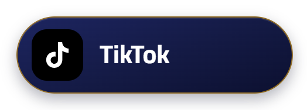</a>
  <a href="https://www.youtube.com/@mohamedabdou-ai"></a>
  <a href="https://www.linkedin.com/in/mohamed-abdou90"></a>
  <a href="https://www.facebook.com/mohamedabdou.ai.90"></a>
</p>

<p align="center">
  <a href="#story">القصة</a> ·
  <a href="#maker">صانع الأداة</a> ·
  <a href="#features">ماذا يفعل لك</a> ·
  <a href="#start">ابدأ في دقيقة</a> ·
  <a href="#ask">اطلب بلهجتك</a> ·
  <a href="#studio">الاستوديو</a> ·
  <a href="#showcase">أمثلة حقيقية</a> ·
  <a href="#faq">أسئلة سريعة</a> ·
  <a href="README.en.md">English</a>
</p>

**اكتب فكرتك بلهجتك، واستلم كاروسيل عربي جاهز للنشر.** هوك يوقف الإبهام في منتصف التمرير، وسلايدات مصممة لموضوعك أنت لا لقالب جاهز، وغلاف يتحرك، وكابشن وهاشتاجات ونص بديل. كل هذا في محادثة واحدة مع Claude، دون أن تفتح برنامج تصميم واحدًا.

ابدأ بما عندك: فكرة في سطر، أو ملاحظات مبعثرة، أو رابط مقال، أو ملف PDF، أو تفريغ حلقة. والباقي على الفريق.

مجاني ومفتوح المصدر، ويعمل في تطبيق Claude على الكمبيوتر والويب والموبايل، وفي Cowork وClaude Code.

<a id="story"></a>

## القصة: لغة يتكلمها 400 مليون، وأدوات لا تفهمها

**أكثر من 400 مليون إنسان يتكلمون العربية كل يوم. ومع ذلك، لا يُكتب بالعربية إلا 0.6% من مواقع الإنترنت.**

محمد عبده يعيش داخل هذه الفجوة كل يوم. يصنع محتوى عربيًا عن الذكاء الاصطناعي، ويرى كل صباح أدوات عالمية مبهرة تعامل العربية كأنها ضيف ثقيل. يكتب الهوك فتتفكك الحروف. يضع رقمًا فيهرب من وحدته. يطلب عنوانًا عربيًا من مولّد صور فيرسم له خطوطًا لا يقرؤها أحد. ويفتح قالبًا جاهزًا فيجده يبدأ الكاروسيل من اليسار، كأن العربية لا تُقرأ من اليمين.

وكل صانع محتوى عربي يعرف بقية القصة: ساعتان على بوست واحد كانت فكرته جاهزة في دقيقة. ثم اختيار مر: أن ينشر بالإنجليزية ليبدو محترفًا، أو ينشر بالعربية ويرضى بشكل أقل.

محمد رفض الاختيارين. بنى فريقًا كاملًا داخل Claude يفهم العربية من أول حرف: يكتب بلهجتك، ويصمم من اليمين، ويحترم كل همزة وكل رقم. جرّبه على حسابه أولًا، بوستًا بعد بوست، ثم قرر أن يتركه مجانيًا ومفتوحًا لكل صانع محتوى عربي.

لأن الفجوة لا يسدها بوست واحد، بل آلاف الصناع الذين ينشرون بالعربية كل يوم، بجودة لا تقل عن أي محتوى في العالم.

> المحتوى العربي يستحق أدوات تُصنع له، لا أدوات تُترجم إليه.

<sub>المصادر: [UNESCO](https://www.unesco.org/en/world-arabic-language-day)، و[W3Techs](https://w3techs.com/technologies/overview/content_language) (أكتوبر 2026).</sub>

<a id="maker"></a>

## صانع الأداة

**محمد عبده**، مؤسس **Pyramedia X** في دبي، وخبير في التسويق الرقمي وأتمتة الأعمال بالذكاء الاصطناعي. يشرح أدوات الذكاء الاصطناعي بالعربي على Instagram وTikTok وYouTube، والأمثلة التي ستراها في هذه الصفحة بوستات حقيقية من حسابه، صنعتها الإضافة من الفكرة حتى النشر.

وهو أيضًا صانع [Reel Studio](https://github.com/mohamedabdou-ai/reel-studio)، استوديو مونتاج الريلز العربية المجاني والمفتوح المصدر.

تريد خطة لأتمتة شغلك بالذكاء الاصطناعي؟ [احجز ساعة استشارة معه](https://store.pyraai.cloud/product/reel-studio/).

<a id="features"></a>

## ماذا يفعل لك الفريق

لا تكتب لأداة، بل تكلّم فريقًا. اضغط على أي بطاقة لتصل إلى تفاصيلها.

<table>
  <tr>
    <td width="50%"><a href="#team"></a></td>
    <td width="50%"><a href="#dialects">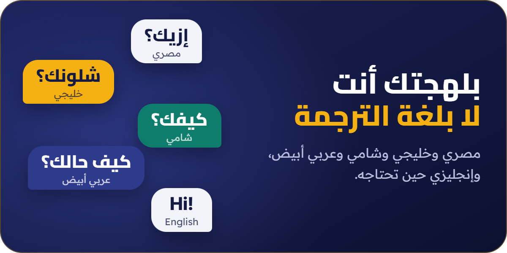</a></td>
  </tr>
  <tr>
    <td width="50%"><a href="#arabic">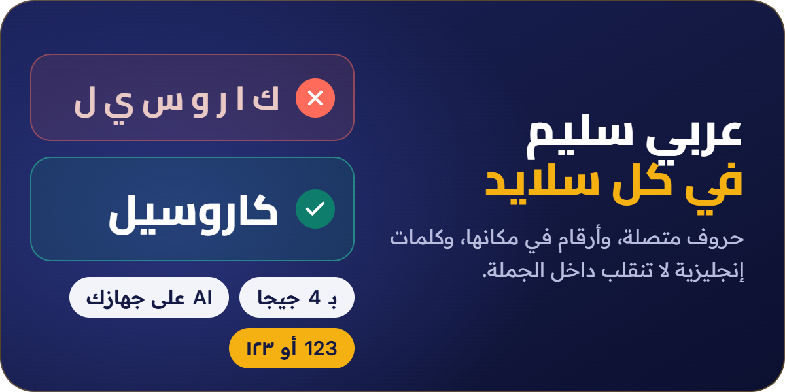</a></td>
    <td width="50%"><a href="#cover">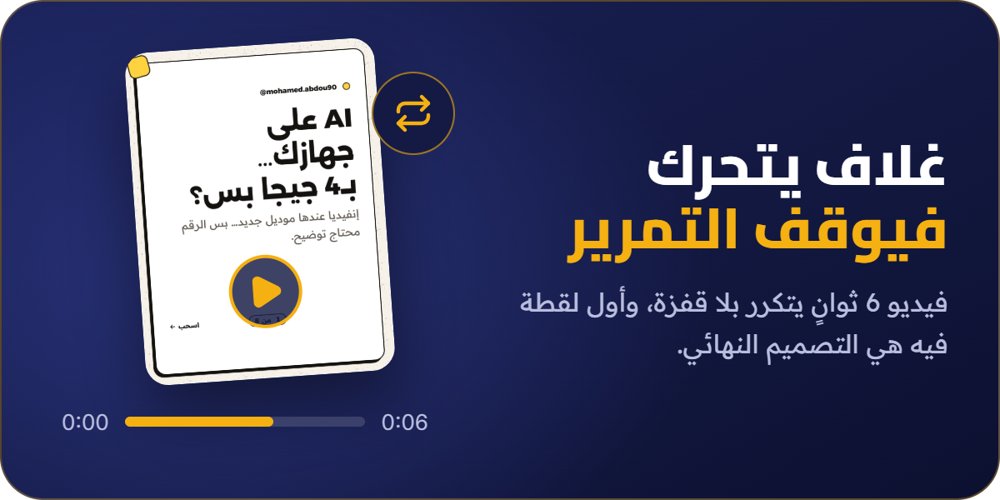</a></td>
  </tr>
  <tr>
    <td width="50%"><a href="#checks">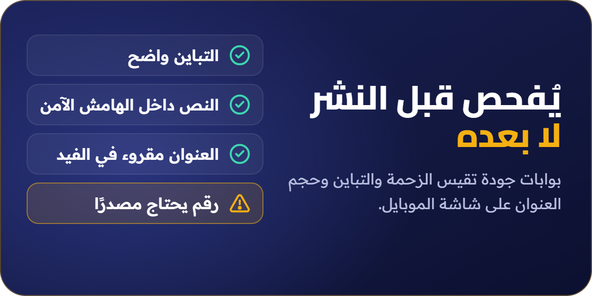</a></td>
    <td width="50%"><a href="#kit">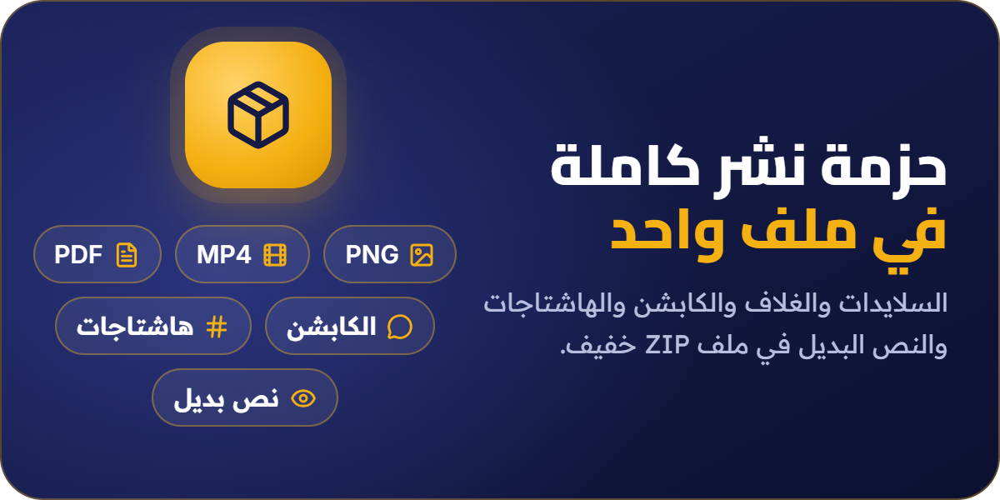</a></td>
  </tr>
</table>

| الميزة | ماذا تعني لك |
| --- | --- |
| <a id="team"></a>**فريق إبداعي كامل** | مدير إبداعي يقرأ طلبك ويعرض عليك اتجاهين: واحدًا آمنًا وآخر جريئًا. ثم يتنافس 12 هوكًا أو أكثر على الغلاف، وتقول لك لجنة من ثلاث شخصيات مأخوذة من جمهورك أين ستتوقف وأين ستكمل التمرير. [تعرّف على الفريق](#flow) |
| <a id="dialects"></a>**بلهجتك أنت** | مصري، وعربي أبيض، وإنجليزي، والخليجي والشامي في مرحلة تجريبية. لهجة واحدة في البوست كله، وبصوتك أنت: يتعلم الفريق نبرتك من براندك، فيخرج الكلام كأنك كتبته بنفسك. |
| <a id="arabic"></a>**عربي سليم** | حروف متصلة، وكلمات إنجليزية وأرقام في مكانها الصحيح، ونظام أرقام واحد في التصميم كله، ورقم لا ينفصل عن وحدته. ومدقق لغوي مستقل يملك حق رفض النص قبل أن يصل إلى التصميم. |
| <a id="cover"></a>**غلاف متحرك** | فيديو MP4 مدته 6 ثوانٍ يدور بلا قفزة، وأول لقطة فيه هي التصميم النهائي، فيبدو صورة ثابتة أنيقة في صفحتك أيضًا. تختار قصة الحركة من تسع قصص، ويُصنع الفيديو داخل المتصفح دون أي تثبيت. |
| <a id="checks"></a>**فحص قبل النشر** | كل سلايد يُراجع قبل أن يخرج: عدد الكلمات، والهوامش الآمنة، والتباين، والمساحة الفارغة، وحجم العنوان على المصغّر، والأرقام التي تحتاج مصدرًا. وكل ملاحظة معها طريقة إصلاحها، وأغلبها يُصلَح بضغطة. |
| <a id="kit"></a>**حزمة نشر كاملة** | سلايدات PNG بمقاس 3:4، ونسخ JPEG بمقاس 4:5 لأدوات الجدولة، والغلاف المتحرك، وملف PDF، والكابشن، وكابشن لكل سلايد، والنص البديل، وخمسة هاشتاجات كحد أقصى. حوالي 3 ميجابايت لثمانية سلايدات. |
| **براندك وذاكرته** | إعداد قصير يتعلم نبرتك وجمهورك وشكلك، ويبني لك كتاب براند تعتمده بنفسك. ويتذكر الفريق ما نشرته وما أعجبك وما رفضته، فلا يكرر عليك الهوك نفسه مرتين. |
| **أدوات صور اختيارية** | إن ربطت أداة توليد صور، تضيف خلفيات بلا نصوص. وبدونها يصمم المحرك الداخلي كل شيء. ولا يكتب الذكاء الاصطناعي حرفًا عربيًا داخل صورة أبدًا. |

<a id="start"></a>

## ابدأ في دقيقة

**من تطبيق Claude، على الكمبيوتر أو الويب:**

1. افتح **Customize** من القائمة الجانبية، ثم تبويب **Plugins**.
2. اضغط **Add**، ثم **Add marketplace**، ثم **Add from a repository**، والصق هذا السطر:

<div dir="ltr">

```text
mohamedabdou-ai/carousel-studio
```

</div>

3. ستظهر لك **Carousel Studio** في **Discover**. افتحها واضغط **Add**.
4. افتح محادثة جديدة وقل **«ابدأ»**.

**ثبّتها مرة واحدة، واستخدمها من أي مكان.** الإضافة تُحفظ على حسابك، فتتبعك إلى كل مكان تفتح فيه Claude: الكمبيوتر، والمتصفح، والموبايل، وCowork، وClaude Code.

**وكل جديد يصلك وحده.** فعّل **Sync automatically** للمستودع الذي أضفته، أو اضغط **Check for updates** متى شئت.

<sub>الإضافات متاحة في كل اشتراكات Claude المدفوعة: Pro وMax وUltra وTeam وEnterprise. وفي Team وEnterprise، إن لم تجد **Add marketplace** فاطلب من مالك حساب المؤسسة (Owner) أن يسمح به.</sub>

<details>
<summary><b>للمطورين: التثبيت من الطرفية</b></summary>

أضفتها من تطبيق Claude؟ ستصلك في Claude Code وحدها عند أول جلسة تفتحها بحساب Claude نفسه، فلا تحتاج هذه الأوامر.

<div dir="ltr">

```text
/plugin marketplace add mohamedabdou-ai/carousel-studio
/plugin install carousel-studio@mohamed-abdou
```

</div>

ولتصلك التحديثات وحدها: افتح <code dir="ltr">/plugin</code>، ثم تبويب **Marketplaces**، واختر <code dir="ltr">mohamed-abdou</code>، ثم **Enable auto-update**. وللتصدير على جهازك أو تجهيز عدة بوستات دفعة واحدة تحتاج Node.js 22 أو أحدث، ومتصفح Chrome أو Edge، وحزمة `playwright-core`.

</details>

<a id="ask"></a>

## اطلب بلهجتك

لا أوامر ولا صيغة معينة. اكتب كما تتكلم:

| ماذا عندك؟ | اكتب له |
| --- | --- |
| **فكرة في سطر** | «اعملي كاروسيل عن أخطاء أول شهر في الشغل الحر» |
| **رابط مقال** | «سوّ لي كاروسيل من هالمقال، وخلّه للمبتدئين» |
| **تفريغ حلقة أو فيديو** | «بدّي كاروسيل من تفريغ الحلقة هاي، خمس أفكار بس» |
| **ملف PDF** | «حوّل هذا الملف إلى كاروسيل من 7 سلايدات» |
| **سكريبت جاهز** | «ده السكريبت، صمّمه بستايل دفتر الملاحظات» |
| **وقت ضيق** | «بسرعة: كاروسيل عن أفضل 5 أدوات للمونتاج» |
| **بوست واحد** | «عايز بوست واحد يعلن عن ورشة يوم الخميس» |
| **خطة الشهر** | «اعمل لي خطة بوستات للشهر الجاي» |
| **بوست منشور** | «راجع الكاروسيل ده»، مع صور البوست |
| **بالإنجليزي** | "Make a carousel about pricing your first freelance project" |

<a id="flow"></a>

## من الفكرة إلى النشر

1. **اطلب.** بفكرة أو مصدر أو سكريبت جاهز.
2. **اختر اتجاهًا.** يعرض عليك الفريق اتجاهين، آمنًا وجريئًا، ولكل واحد سطر غلاف.
3. **راجع السكريبت.** يفتح في الاستوديو سلايدًا سلايدًا، وبجانبه الهوكات التي حلّت بعد الفائز لو أردت التبديل.
4. **قل «صمّم».** يصمم المدير الفني كل سلايد على مقاس موضوعك، ويفحص منتج الجودة كل سلايد بحجمه الكامل وبحجمه في الفيد.
5. **صدّر وانشر.** تستلم حزمة النشر كاملة في ملف ZIP واحد خفيف.

مستعجل؟ قل **«بسرعة»**، ويعمل فريق أصغر بخطوات أقل.

### الفريق

| الدور | ماذا يفعل |
| --- | --- |
| **المدير الإبداعي** | يكتب الموجز، ويختار بين الاتجاهين، ويحسم منافسة الهوكات، ويعطي الحكم النهائي. |
| **المخطط الاستراتيجي** | يستخرج زوايا الطرح من مصدرك ويقيّمها، ويتحقق من الحقائق التي يقوم عليها البوست. |
| **كاتب الكاروسيل** | الهوكات والسكريبت والكابشن وكابشن كل سلايد والنص البديل، بلهجتك ونبرتك. |
| **المدقق اللغوي** | يراجع النص وحده ومعه القواعد فقط، ويملك حق الرفض. |
| **لجنة الجمهور** | ثلاث شخصيات من جمهورك تقول أين ستتوقف، وماذا ستحفظ، ولمن سترسل البوست. |
| **المدير الفني** | يختار الستايل، ويصمم السلايدات، ويراجع الصور النهائية واحدة واحدة. |
| **مصمم الحركة** | يختار قصة الغلاف، ويعرضها عليك في 6 لقطات قبل التصدير، ويتأكد أن الفيديو يدور بسلاسة. |
| **فنان الصور** | يكتب أوصاف خلفيات بلا نصوص، ويعمل فقط إن ربطت أداة صور. |
| **منتج الجودة** | يفحص كل سلايد ويملك حق الرفض التقني، ويجهّز حزمة النشر. |

<a id="studio"></a>

## الاستوديو: راجع كل شيء قبل أن تنشر

صفحة تفتح في المتصفح، على الموبايل أو الكمبيوتر. تعدّل النص في مكانه، وتبدّل الستايل وترى غلافك أنت بالستايلات الثلاثة، وتعاين البوست في الفيد وبحجم المصغّر، ثم تصدّر.

<p align="center"><a href="docs/readme/shot-studio.jpg">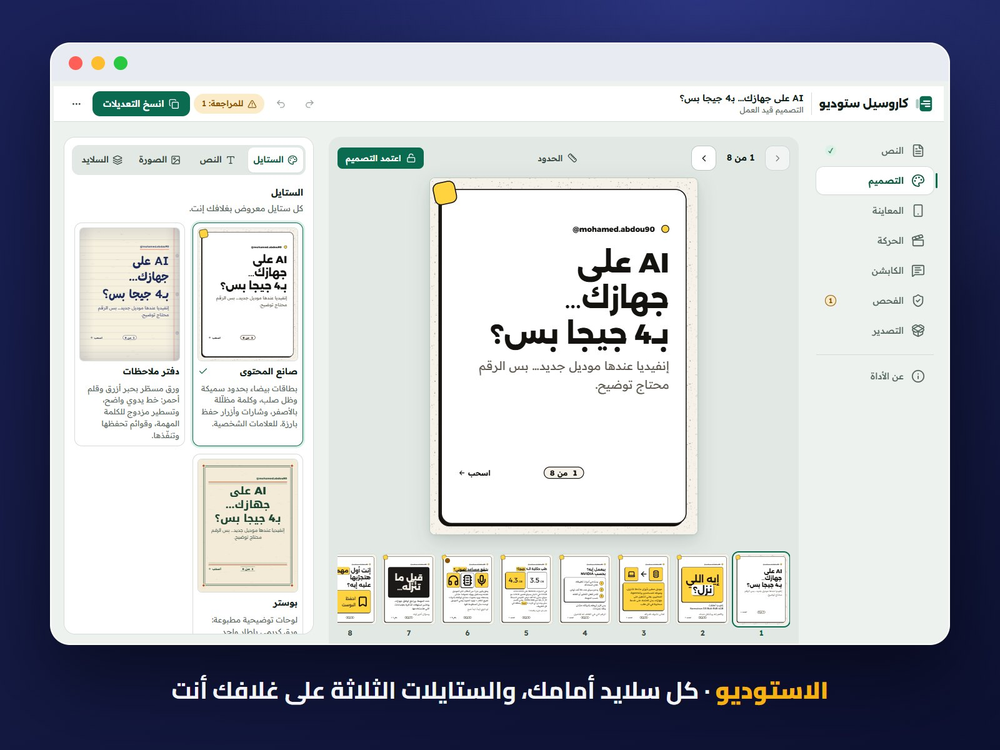</a></p>

<p align="center"><a href="docs/readme/shot-tabs.jpg">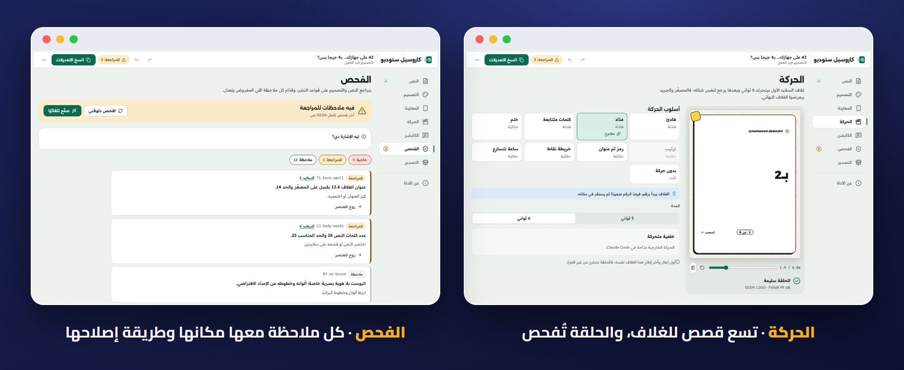</a></p>

<p align="center"><sub>لقطات حقيقية من الاستوديو. اضغط على أي صورة لعرضها بحجمها الكامل.</sub></p>

<a id="showcase"></a>

## أمثلة حقيقية

بوستات من حساب محمد عبده، صنعتها الإضافة من الفكرة حتى التصدير. السلايد الأول على اليمين، كما يُقرأ الكاروسيل العربي.

<p align="center">
  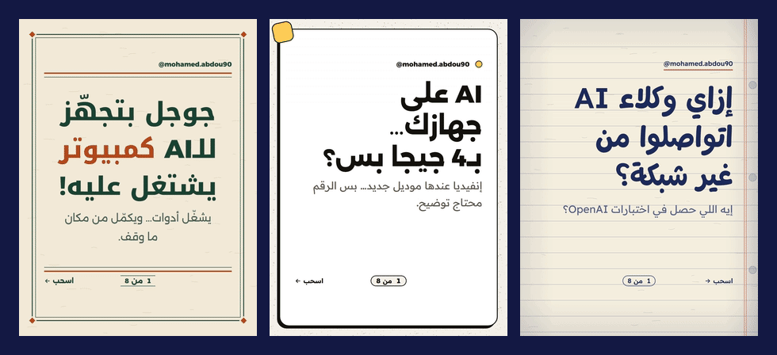
</p>

**صانع المحتوى**: بطاقات بيضاء بحدود سميكة، وظل صلب، وأصفر للعلامات المهمة.

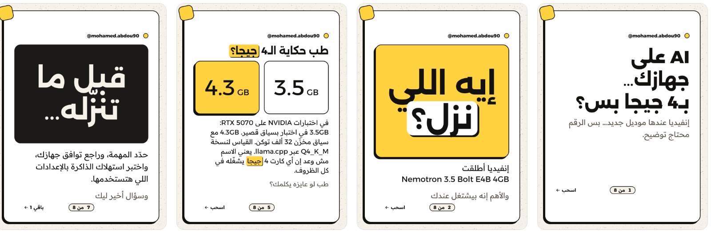

**بوستر**: لوحة توضيحية مطبوعة بإطارات مسطّرة.

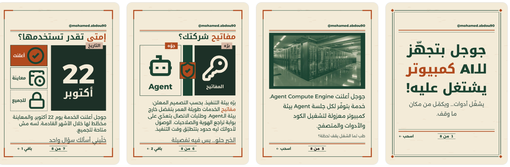

**دفتر ملاحظات**: ورق مسطّر، وقلم أحمر، وخط يدوي واضح.

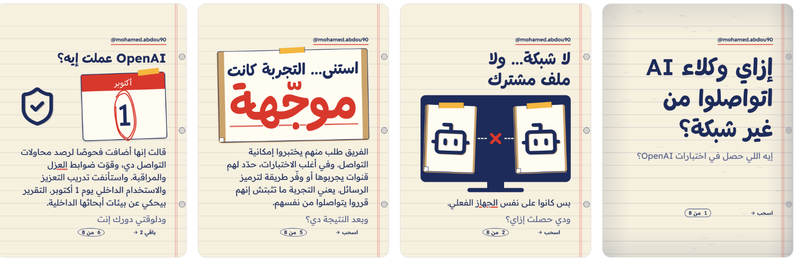

<details>
<summary><b>الأوامر المختصرة</b></summary>

لا تحتاجها. اكتب ما تريد وستبدأ المهارة المناسبة وحدها. لكنها موجودة لمن يحب الاختصار:

| الأمر | ماذا يفعل |
| --- | --- |
| <code dir="ltr">/carousel</code> | كاروسيل من فكرة أو من سكريبت جاهز |
| <code dir="ltr">/post</code> | بوست بصورة واحدة |
| <code dir="ltr">/brand</code> | إعداد البراند أو تعديله |
| <code dir="ltr">/plan</code> | خطة البوستات للأسبوع أو الشهر |
| <code dir="ltr">/audit</code> | مراجعة كاروسيل نشرته، من لقطات الشاشة |
| <code dir="ltr">/studio</code> | فتح الاستوديو والتصدير |

</details>

<a id="faq"></a>

## أسئلة سريعة

<details>
<summary><b>هل الإضافة مجانية فعلًا؟</b></summary>

نعم، مجانية بالكامل ومفتوحة المصدر بترخيص Apache 2.0، ولا يوجد اشتراك ولا حساب داخل الإضافة. كل ما تحتاجه اشتراك Claude مدفوع، لأن الإضافات متاحة في كل الاشتراكات المدفوعة: Pro وMax وUltra وTeam وEnterprise.

</details>

<details>
<summary><b>هل أحتاج خبرة برمجة أو طرفية؟</b></summary>

لا. تثبّتها من إعدادات تطبيق Claude بضغطات قليلة، ثم تكلّمه كما تكلّم زميلًا في الفريق. لا أوامر، ولا كود، ولا طرفية.

</details>

<details>
<summary><b>هل يكتب بلهجتي فعلًا؟</b></summary>

المصري والعربي الأبيض والإنجليزي جاهزة، والخليجي والشامي في مرحلة تجريبية. وفي كل الأحوال تقدر تعدّل أي كلمة بنفسك في الاستوديو قبل التصدير.

</details>

<details>
<summary><b>هل سيكتب الذكاء الاصطناعي نصًا عربيًا داخل الصور؟</b></summary>

لا، أبدًا. كل حرف عربي في التصميم يُكتب بخطوط حقيقية داخل المحرك، وأدوات الصور، إن ربطتها، لا تصنع إلا خلفيات بلا نصوص.

</details>

<details>
<summary><b>هل أقدر أستخدم ألوان وخطوط البراند الخاص بي؟</b></summary>

نعم. في الإعداد الأول تضيف ألوانك وخطوطك وأمثلة من شغلك، فيطبقها الفريق على كل ستايل. ولو تركتها، يحتفظ كل ستايل بألوانه.

</details>

<details>
<summary><b>هل ينشر على Instagram مباشرة؟</b></summary>

الإضافة تجهّز الملفات ولا تنشر بنفسها. بعد موافقتك تسألك مرة واحدة أين وكيف تريد النشر: يدويًا، أو بأداة متصلة تختارها. تتذكر تفضيلك، وتتبع تعليمات الأداة وحدودها بإذنك في كل استخدام، للحسابات والمنصات التي تسميها.

</details>

<details>
<summary><b>لمن حقوق ما أصنعه؟</b></summary>

لك وحدك، وكما نقولها دائمًا: كل اللي بتعمله بكاروسيل ستوديو بتاعك. ولا يظهر اسم صانع الأداة على أي ملف تصدّره.

</details>

<a id="privacy"></a>

## بياناتك

**هذه الإضافة لا ترسل أي بيانات.** لا يوجد خادم ولا حساب ولا كود تتبّع. براندك وبوستاتك تبقى حيث تحفظها: في مشروعك وملفاتك داخل Claude، أو في مجلد على جهازك. والتفاصيل كاملة في [PRIVACY.md](PRIVACY.md).

<a id="roadmap"></a>

## قريبًا

- **في الإصدار القادم:** ثلاثة ستايلات جديدة، وحزم المناسبات بدءًا برمضان.
- **بعدها:** التسليم إلى Canva، وتحليلات حسابك، والدارجة المغاربية، ومقاسات الستوري وLinkedIn. النشر بأداتك المتصلة يتبع تعليماتها واختيارك، دون وصفة نشر مدمجة.

ثبّتها الآن، وكل جديد يصلك بتحديث واحد. وما تغيّر في كل إصدار تجده في [سجل التغييرات](CHANGELOG.md).

## الترخيص والاسم

رخصة Apache 2.0 ([LICENSE](LICENSE))، والمكونات الخارجية ورخصها في [NOTICE](NOTICE). اسم «كاروسيل ستوديو» و"Carousel Studio" والشعار محفوظة، فعلى النسخ المشتقة أن تختار اسمًا آخر ([TRADEMARKS.md](TRADEMARKS.md)). كاروسيل ستوديو مشروع مستقل عن Anthropic، و"Claude" علامة تجارية لـAnthropic.

<a id="contribute"></a>

<details>
<summary><b>للمطورين والمساهمين</b></summary>

| المسار | ماذا فيه |
| --- | --- |
| `plugins/carousel-studio` | الإضافة نفسها، وهي المجلد الوحيد الذي يُشحن: المهارات والأوامر والوكلاء والمحرك والخطوط والستايلات |
| `team` | ميثاق الفريق وأدواره، ومنها يُبنى الوكلاء |
| `src` | مصادر المحرك، وتُبنى داخل الاستوديو |
| `tools` | البناء والمزامنة وفحوص الدليل والإصدار |
| `tests` و`evals` | الاختبارات ومجموعات الجودة واختبارات السلوك |
| `docs` | عقد البناء والأمثلة وصور هذه الصفحة |

طريقة المساهمة في [CONTRIBUTING.md](CONTRIBUTING.md).

</details>

<h2 align="center">صنعه محمد عبده، للمحتوى العربي</h2>

<p align="center">
  <a href="https://store.pyraai.cloud/product/reel-studio/"></a>
  <a href="https://github.com/mohamedabdou-ai/carousel-studio"></a>
</p>

<p align="center">
  <a href="https://www.instagram.com/mohamed.abdou90"></a>
  <a href="https://www.tiktok.com/@mohamedabdou.ai"></a>
  <a href="https://www.youtube.com/@mohamedabdou-ai"></a>
  <a href="https://www.linkedin.com/in/mohamed-abdou90"></a>
  <a href="https://www.facebook.com/mohamedabdou.ai.90"></a>
</p>

<p align="center">الأداة مجانية، وكلمة شكر أو ذكر لصاحبها تفرق كثيرًا.<br><a href="https://store.pyraai.cloud">متجر محمد عبده</a></p>

</div>

الحد الأقصى للكاروسيل 10 شرائح بما فيها الغلاف الثابت أو المتحرك، ليتوافق مع واجهة النشر في Instagram ومعظم أدوات الجدولة. الكاروسيل القصير من 4 إلى 6 شرائح مقبول. تصدير MP4 يحمّل مكتبة `mediabunny` 1.61.0 فقط من `cdn.jsdelivr.net`؛ إنشاء ZIP مدمج في الأداة.
